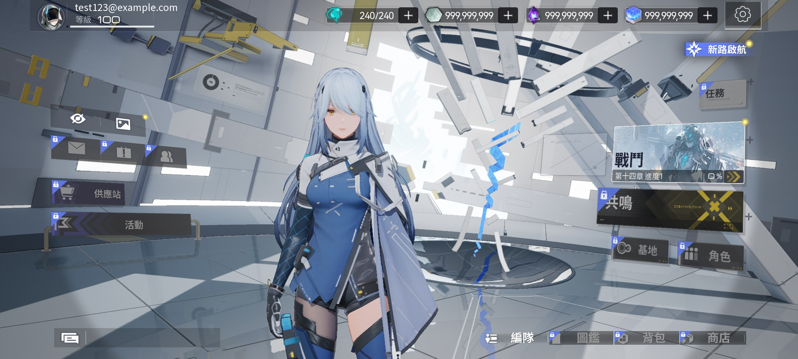

# 07 · 完整跑一遍的过程

环境：国产 ROM（Android 14）+ arm64，全程没有 root，游戏和组件装在副用户（`user 12`）里。只留跟复现有关的，设备标识、序列号、路径都去掉了。

## 时间线

| 时间 | 事件 | 结果 |
|---|---|---|
| — | 客户端改包 + 重签 | 重打包成功，可安装 |
| — | 装进副用户 | 走系统安装器（`file://`），adb 直装被 ROM 拦了 |
| — | 安装并启动服务端 | `0.0.0.0:31000` LISTEN，界面显示运行中 |
| 18:36 | 导入 VPN 配置并启动 | tun 建立，规则被接受 |
| 18:47 | 启动客户端 | SDK 初始化 → 探测 → serverlist → 登录均通 |
| 18:47–20:23 | 26.17 GB 资源更新 | 1 小时 36 分，平均约 4.5 MB/s，中途多次切换 CDN 节点 |
| 20:23 | 更新完成 → 进入主页 | 账号为本地测试账号，等级 100，UI/资源正常 |
| 20:28 | 长连接验证 | `127.0.0.1:<port> -> 127.0.0.1:31000 ESTAB` |

## 关键节点

### 卡在「伺服器尚未开放」

serverlist 走 443，规则是按域名匹配的。当时漏了 `sniff`，域名规则一次都没命中过。加一条非终结的 `sniff` 之后马上通了。

### 更新时以为网络坏了

那会儿进度几乎不动，日志里全是重试。后来拿 PC 不挂 VPN 直连同一个 URL，一样慢，才确定是境外 CDN 的事，跟手机和 VPN 都没关系（见 docs/05）。换到快节点后回到 6–8 MB/s。

### 更新完的登录

第一次进去要编译着色器，一次性的事，挺久。之后基本秒进。

## 验证证据

```bash
# 客户端 ↔ 本地服务端
$ adb shell ss -tn | grep 31000
ESTAB 0 0 127.0.0.1:44610 127.0.0.1:31000

# serverlist 返回
[{"platform":"Android_ASTC","version":"3.6.0","host":"127.0.0.1","port":31000}]
```



## 复现要点，顺序别错

1. 服务端先起来（31000 在听）；
2. VPN 再起来（tun + 规则）；
3. 客户端最后启动；
4. 更新阶段保持正常外网（规则不改写 CDN 域名）；
5. `include_package` 只放游戏包名。

---

## 第二轮（v2）：资源包下载「0%」实测

第一轮跑通之后，回头复核「下载弹窗卡在 0%」这个反馈，方法见 docs/05。

| 时间 | 事件 | 结果 |
|---|---|---|
| 13:37 | 删除已下载的语音包 | 条目回到可选状态，用于复现 |
| 13:43:26 | 勾选中文配音（876.95 MB）点下载 | 弹窗显示「下載中：0%」 |
| 13:43–13:45 | 采样磁盘与 tun | 两者都不动（约 2 分钟空转） |
| 13:45:40 | 开始有收包 | 速率 9–13 MB/s |
| 13:46:33 | 截图核对 | 弹窗已自行消失，传输仍在继续 |
| 13:47 | 传输结束 | 列表条目变为「已下載」 |

算下来磁盘少了约 878 MiB，跟包体 876.95 MB 对得上；tun0 入向累计涨了 956 MB。UI 百分比全程 0%，东西其实完整下完了。

这一轮还顺带确认了两件事：

- `準備更新 95.x%` 不是死锁。那会儿游戏主进程单核跑到 90%、161 个线程、磁盘和网络都不涨，是本地校验，验完直接跳 100%。
- 排查时临时加的 `reject` 诊断规则已经撤了。复核过 `include_package` 只含游戏包名，浏览器上网时 tun 里看不到浏览器的连接。最终配置见 `configs/sfa-vpn.example.json`。
